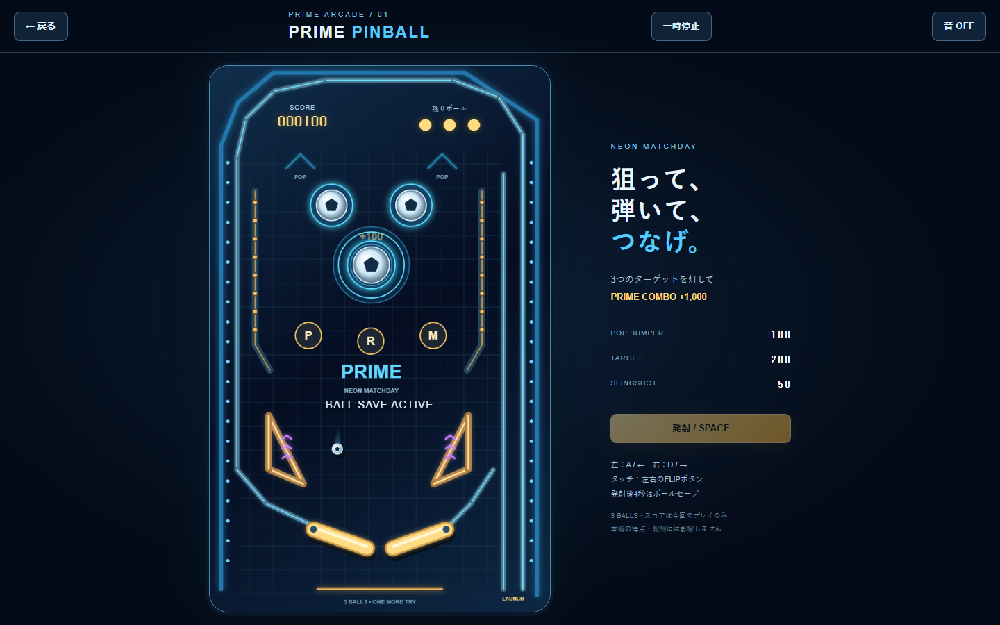

# PRIME PINBALL — Phase 1

既存の右サイドバー（PC / スマホ）の PINBALL アイコンから、同じタブ内の独立ゲームへ入ります。新しいホームやステージ選択はありません。戻ると本編の一時停止画面へ戻り、ユーザーが再開します。

## 遊び方
- PC：A / ← が左フリッパー、D / → が右フリッパー。Space で発射、Esc で一時停止。
- スマホ：左右 FLIP を同時押し可能。発射・再開・再挑戦は中央操作ボタン。
- 3球制。発射直後4秒は落球を救済。バンパー100、ターゲット200、スリング50。
- P / R / M をすべて灯すと追加1,000点。ゲーム終了後に再挑戦可能。
- 音は初期OFF。今回のスコアのみ表示し、保存・オンラインランキング・報酬はなし。

## 分離と変更範囲
`pinball.html` / `pinball.css` と `js/pinball-{engine,game,entry}.js` に独立。固定1/240秒の物理、描画、入力を本編と共有しません。入口は既存のダイアログ一時停止処理を利用し、表示中は背景を inert にします。閉じると iframe を破棄し入力・音・ループを終了します。

本編の game.js、engine、touch、ランキング、デイリー、称号、Supabase、Worker は変更していません。BOOST表示場所は将来方針のみで、所持数・付与・消費・DB連携は実装していません。

## 検証（2026-10-20）
- `npm test` 成功。新規7件：発射経路、3球終了とリセット、ボールセーブ、3ターゲットボーナス、可動フリッパーの上向き反射、中央落球、長時間の決定性・有限値・速度上限。
- `npm run build` 成功。新規 HTML/CSS/JS を配布対象に追加。
- ローカル Edge / Playwright：1440×900で入口→発射→一時停止/再開→戻る。JavaScriptエラーなし。背景の inert 復元を確認。
- モバイルエミュレーション：844×390 / 390×844。横はみ出しなし、台の縦横比維持、pointercancelで入力解除。
- ブラウザ検証を再実行する場合：PlaywrightとEdgeがある環境でローカルサーバーを起動し `node scripts/pinball-smoke.cjs`。PINBALL_BASE_URL（既定8781）とPINBALL_SCREENSHOTS（既定OS一時フォルダ）で変更可能。
- 本番ブラウザ、実機スマホ、実測FPS/電池消費は未検証。CI結果とは別扱い。自動テストは「面白さ」の保証ではないため、実プレイによる反発・難易度の評価をお願いします。

## ユーザー確認
1. PCとスマホでアイコンから入って戻れるか。本編が勝手に進まず再開できるか。
2. 左右フリッパーのタイミング、球速、狙い方が楽しいか。
3. 3球・セーブ・加点・再挑戦が分かりやすいか。
4. スマホの同時押し、指を離す/画面を切り替える操作で入力が残らないか。
5. 本編の操作、デイリー、ランキングに変化がないか。

