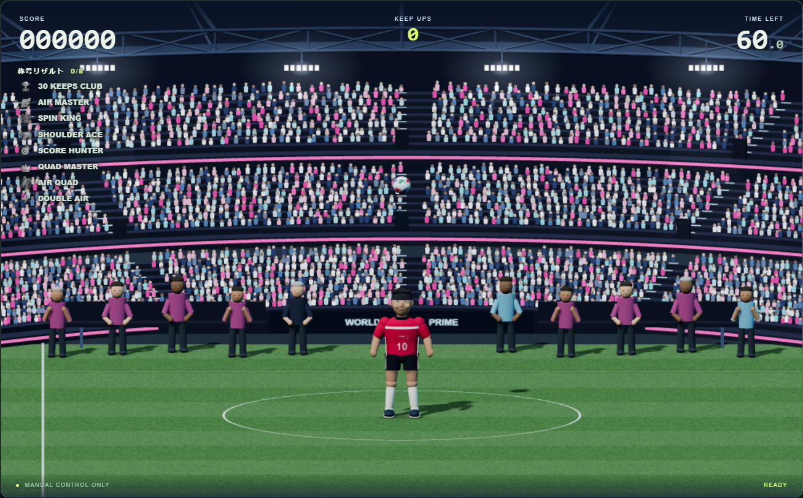

# WORLD ARENA / shared player: PC review

Base: origin/main 42def6b. PC presentation is the priority. Mobile redesign and optimization are deferred; existing touch behavior receives regression checks only.

## Changes
- Three genuinely stepped, curved stadium tiers, 7,104 instanced spectators in pink / ice blue / white, illuminated gangways, pink LED rims and a triangulated roof ring.
- Separate night lighting, visible lamp banks, subtle light shafts, horizontal textured turf and center circle. Ten grounded substitutes / manager / staff; no training trees, cones or fence.
- Shared `js/player-model.js`: shaped cloth, tapered limbs, shoulder joints, cheek / ear details, sleeve trim and boot studs. Kit IDs, colors and selection remain unchanged.
- Renderer keeps original player / ball coordinates, camera projection and contact poses. Arm swing and torso balance are visual only. Reusable vector scratch storage avoids per-bone vector allocation.
- PC-only stadium HUD colors; preview button remains transparent, keyboard focus reveals it. Unlock logic stays at eight titles.

## Validation
`npm test`: 39 checks passed. `npm run build`: passed.
Optional `tests/arena-capture.cjs` uses Playwright + installed Edge and an offline local server. 32 pose variants, 44 kits and the same model on both stages; frozen engine snapshots render without mutation. Stage switching preserves camera / game state and GPU resource counts. Existing lock / unlock / reset events pass. Touch landscape loads with controls and no page errors.

Headless Edge at 1920 × 1080: 141 render calls, 721,830 triangles, 4.2 ms median / 4.8 ms p95 frame interval. These are local test results, not a real-device performance guarantee. Resource counts remain 86 geometries / 15 textures across twenty stage switches.

`game.js`, `js/engine.js`, `js/config.js`, `js/kits.js`, `js/ranking.js`, `js/touch.js`, server code and database configuration are unchanged from main. No production network / DB operations were performed. Ranking tests use mocks; production login / saving were not exercised.

## PC acceptance checks
- Enter WORLD ARENA: three separate tiers, roof, neon and floodlights should read as a special venue.
- Confirm player / ball / HUD visibility during foot, knee, chest, both shoulders, header, jumping and spins.
- Change uniforms and compare the player in TRAINING LAB and WORLD ARENA.
- Confirm lighting / cloth / anatomy against the concept image; visual approval remains outstanding.
- Check normal gameplay and existing ranking flow in the deployed review environment.

Mobile layout work is intentionally out of scope. A later phase will optimize it after PC visual approval.

The repo contains old tracked public output. Build from root sources before deployment; generated unrelated main updates are intentionally excluded from this visual PR. Do not merge or deploy production before user approval.
